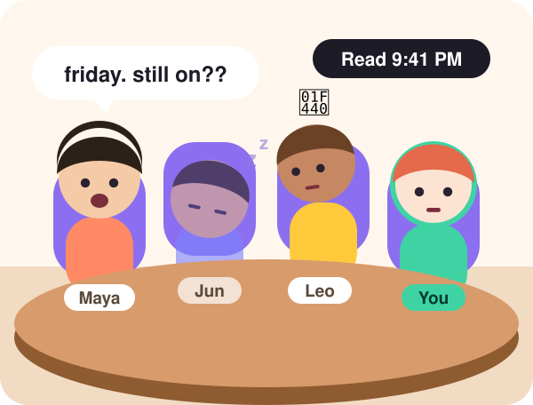

<div align="center">



# Scene

### Group chats you can see.

Your group chat becomes a round table. Friends who are watching sit up.<br>
Friends who aren't are face-down on the table. You talk in your own voice.


**[Live demo](https://scene-ujhs.vercel.app)** · [Pitch (PDF)](docs/pitch/Scene-pitch.pdf) · [Product design](docs/designs/group-chat-scene.md) · [Business model](docs/designs/scene-business-model.md) · [Market data](docs/research/global-market-stats.md)

</div>

---

## The idea

Chat apps keep the words and shrink everything else. Who is in the room right now, who read your message and said nothing, who answered three hours later: all of it is a grey number or a "Read 9:41" label.

Scene puts those signals back on the characters, as body language:

| In a chat app | At Scene's round table |
|---|---|
| You can't tell who is looking right now | 🪑 Whoever is watching sits up. Everyone else is slumped on the table |
| "Read 9:41" and no reply | 👀 They lift their head, stare at you, and slump back down |
| A reply three hours later | 💦 They jolt upright |
| "Leo left the chat" | 🚪 They push the chair back and walk out. The seat stays empty |
| "This message was deleted" | ✋ They clap a hand over their mouth mid-sentence |

## Where it started

- **Star Wars hologram calls.** People far apart still sit around one table and talk, like the [Shadow Council in *The Mandalorian* season 3](https://www.youtube.com/watch?v=9EuKI_R8SLs).
- **Rukichi's "남자들의 단톡방" (the guys' group chat).** When people act a group chat out loud, one "left on read" turns into a sketch ([YouTube, 2.5M views](https://www.youtube.com/watch?v=Rr8CZr-3KgM)).
- **An avatar you dressed yourself.** Scene puts both into the group chat you already use, with your character in the seat instead of your face. Gen Z cares about this: 56% of US/UK Gen Z say styling their avatar matters more than styling themselves (Roblox, 2023).
- **Next stop: glasses.** On smart glasses the round table sits on your desk, which is about as close to a hologram call as it gets.

## Try it

1. Read one line out loud so your avatar can speak in your voice. You can skip this.
2. Dress your character in My Room, then pull up the sheet and open **Friday plans**.
3. Tap 🎤 and say something, or type. Then watch who leaves you on read.

The demo room is scripted. Friends speak in AI voices; your 🎤 messages are your real voice, and typed ones can use your cloned voice.

## Why now

| | |
|---|---|
| **90%** of US smartphone users tell a group chat big news before they post it on social media. Over half of Gen Z say their group chat knows their daily life better than their family does. | Giphy / Censuswide, n=2,000, 2025 |
| **7 billion** voice messages a day on WhatsApp alone, still played back as a list of blue bars. | WhatsApp, 2022 |
| **68%** of Messenger users surveyed have avoided opening a message just to dodge the "Seen" receipt. | Hoyle et al., CHI 2017 (US) |
| **25M+** people pay for Snapchat+, whose perks include showing a friend's Bitmoji when they're in your chat. | Snap, 2026 |

Sources and more numbers: [`docs/research/global-market-stats.md`](docs/research/global-market-stats.md).

## Business model (plan)

- **Free:** sitting and slumping, the voice round table, a starter character.
- **First revenue: dressing up your character.** Outfits, faces and expressive gestures such as hearts and laughs. Your character sits at every table you're in, so friends see what you bought every day. 52% of US/UK Gen Z are comfortable spending up to $10 a month on avatar fashion (Roblox, 2023).
- **Room themes:** a table theme or chairs one friend buys for the whole room, the way Discord server boosts work.
- **Growth:** 15-second clips of a chat moment, free with a watermark.
- **Before opening the shop:** 10 friend groups for 14 days. At least 3 must still be talking on their own on day 14.

Reasoning, risks and the test plan: [`docs/designs/scene-business-model.md`](docs/designs/scene-business-model.md).

## How it works

- **App:** Next.js App Router, rendered client-side only. It needs `localStorage`, Web Audio and WebGL.
- **Characters:** 3D avatars built with react-three-fiber. A motion engine (`src/lib/motion`) turns pose names into joint angles. Devices without WebGL, or a canvas that throws, fall back to 2D characters.
- **Rooms:** each room is a script of beats such as `talk`, `read_ignore`, `startle_up` and `stand_leave`, plus reactions to your own messages. The beat player plays each line's audio (AI voices from `/api/tts`) through Web Audio and moves mouths with the talk level.
- **Your voice:** 🎤 records with `MediaRecorder` and plays back on your device. Browser speech recognition fills the bubble when it's available.
- **Voice cloning (optional):** `/api/voice/enroll` and `/api/voice/speak` clone your voice and speak typed messages with it, through ElevenLabs or a self-hosted GPT-SoVITS server. Keys stay on the server. Without a provider, messages fall back to text bubbles.

## Run locally

```bash
npm install
npm run dev
```

Open http://localhost:3000. It works best at phone width.

Keys go in `.env.local` (gitignored; copy `.env.example`), and in the Vercel project's environment variables for the deployed demo. Never commit a file with real values.

The AI summary in "Friday plans" and the AI friend Ari call Claude Sonnet from the server:

```bash
ANTHROPIC_API_KEY=sk-ant-...
```

Without a key both still work: the room shows a written summary and Ari answers with a fallback line.

Friends' lines in "Friday plans" and Ari's replies are spoken by OpenAI text-to-speech (`gpt-4o-mini-tts`, one voice per character, set in `src/app/api/tts/route.ts`). Scripted lines are generated once and cached by the CDN:

```bash
OPENAI_API_KEY=sk-...
```

Without it the friends' lines show as bubbles.

Voice cloning is off unless you set one provider:

| Variable | Use |
|---|---|
| `VOICE_PROVIDER` | `elevenlabs` or `sovits`. Leave it unset to turn cloning off |
| `ELEVENLABS_API_KEY` | ElevenLabs key, for `elevenlabs` |
| `SOVITS_URL` | GPT-SoVITS `voice_server.py` URL, for `sovits` |
| `SOVITS_KEY` | Shared key that server expects, sent as `x-voice-key` |

## Privacy

- 🎤 messages at the table stay on your device as local audio. Scene never uploads them. If your browser turns speech into bubble text, it may use the browser maker's speech service.
- Voice setup is optional. If you do it, the one line you read goes through our server to the voice provider, and so do the messages you type afterwards. The live demo uses a GPT-SoVITS server the team runs itself, not a third-party service.
- Messages you send to Ari go through our server to Anthropic's API for a reply, and Ari's reply goes to OpenAI to be spoken. Friends' scripted lines are also voiced by OpenAI. Without those keys nothing is sent and the room falls back to bubbles.

## Project layout

| Path | What |
|---|---|
| `src/app/` | Entry page and the `/api/voice`, `/api/tts`, `/api/summary` and `/api/agent` routes |
| `src/components/myroom/` | My Room and the wardrobe |
| `src/components/sheet/` | Apple Maps-style bottom sheet, room cards, friends |
| `src/components/room/` | Round table, bubbles, mic and text composer |
| `src/components/avatar/` | 3D avatar, room and home stages, 2D fallback |
| `src/components/VoiceSetup.tsx` | First-run voice setup popup |
| `src/lib/player/` | Beat player, Web Audio playback, talk level |
| `src/lib/motion/` | Pose and joint motion engine |
| `src/data/` | Demo room, friends and the AI friend Ari |

## Docs

- [`docs/designs/group-chat-scene.md`](docs/designs/group-chat-scene.md): product design and reasoning
- [`docs/designs/scene-business-model.md`](docs/designs/scene-business-model.md): business model, risks, 14-day test
- [`docs/research/global-market-stats.md`](docs/research/global-market-stats.md): global market data with sources
- [`docs/pitch/`](docs/pitch/): two-page pitch (HTML source and PDF)
- [`docs/WORK-SPLIT.md`](docs/WORK-SPLIT.md): who does what, timeline, submission gate
- [`docs/AVATAR-SLOT.md`](docs/AVATAR-SLOT.md): how the avatar plugs in

---

<div align="center">
Built in one day by team UJHS (노강민, 이주현) for the SCHMIDT track, "the interface after the chat window."
</div>
